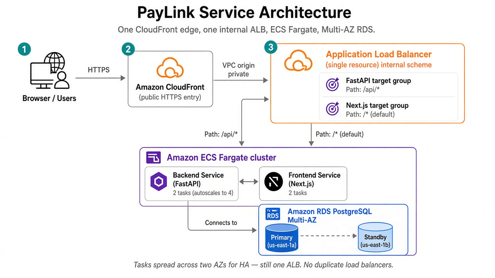
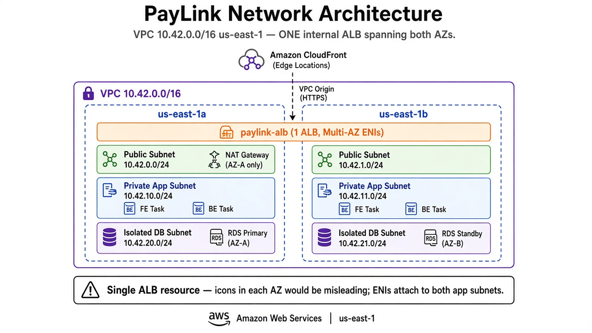

# PayLink on AWS

Infrastructure-as-Code deployment of PayLink (Next.js + FastAPI + PostgreSQL) on AWS, matching the course service and network diagrams.

This isolated class stack uses Amazon RDS PostgreSQL for all application data and Amazon S3 for remote application Terraform state. **Do not provision, deploy, run AWS tests, or tear down without Venkatasai's explicit approval.** See the [AWS guide and service inventory](docs/AWS_GUIDE.md) and [estimated costs](docs/COST_NOTES.md).

## Architecture

**Important:** there is **one** internal ALB (Multi-AZ ENIs). ECS tasks in each AZ are HA capacity, not a second ALB.





```
Browser --HTTPS--> CloudFront --VPC Origin (private)--> Internal ALB (1)
                                                          |
                              +---------------------------+---------------------------+
                              | /api/*                    | default /*
                              v                           v
                     FastAPI (ECS Fargate x2–4)    Next.js (ECS Fargate x2)
                              |
                              v
                     RDS PostgreSQL Multi-AZ (isolated subnets)
```

- **Region:** `us-east-1`
- **VPC:** `10.42.0.0/16`
- **Public:** `10.42.0.0/24`, `10.42.1.0/24` (NAT in AZ A only)
- **Private app:** `10.42.10.0/24`, `10.42.11.0/24` (ECS tasks; ALB ENIs attach here)
- **Isolated DB:** `10.42.20.0/24`, `10.42.21.0/24` (RDS primary + standby)
- **Edge:** CloudFront VPC origin → **single** internal ALB (no public IP on the ALB)

## Layout

| Path                                  | Purpose                                      |
| ------------------------------------- | -------------------------------------------- |
| `terraform/`                          | Application IaC and mocked plan tests       |
| `terraform/state/`                    | Versioned, encrypted S3 state bucket IaC     |
| `docker/`                             | Images for ECR                               |
| `scripts/`                            | Build/push, plan helpers, DB bootstrap       |
| `docs/diagrams/`                      | Service + network diagrams (1 ALB clarified) |
| `docs/PROFESSOR_QA.md`                | 2 nodes, CloudFront+ALB, ALB/AZs, Fargate    |
| `docs/DEPLOYMENT_GUIDE.md`            | Deploy steps                                 |
| `docs/SCREENSHOTS_AND_VIDEO_GUIDE.md` | Evidence index                               |
| `docs/COST_NOTES.md`                  | Cost / shutdown                              |
| `docs/EXPERIMENTS.md`                 | Scaling / failover labs                      |
| `artifacts/screenshots/`              | UI, Console, ad-hoc proof                    |
| `artifacts/video/`                    | Showcase MP4                                 |

## Validate and deploy

Use the [deployment runbook](docs/DEPLOYMENT_GUIDE.md) for offline validation and the approval-gated sequence: configure S3 state → plan the foundation → publish ARM64 images → bootstrap the database → enable ECS services → verify through CloudFront → tear down the disposable stack.

## Professor Q&A

[docs/PROFESSOR_QA.md](docs/PROFESSOR_QA.md) — why 2 nodes, CloudFront + ALB / VPC origin, one ALB across AZs, Fargate via IaC.
